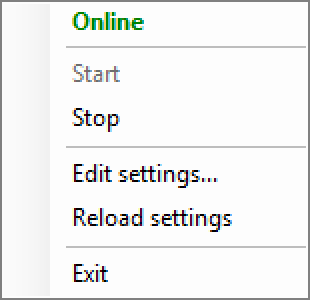

# Awake

A tiny Windows tray app that keeps your PC awake, so that your agents keep running.



## Features

- **Idle-aware.** It does nothing while you're using the PC. After 3 minutes without input, it nudges the mouse 1 pixel and straight back. There are no clicks, and you won't see the pointer move.
- **Stops sleep.** While it's Online, it also tells Windows not to sleep or turn off the display.
- **On/off from the tray.** Right-click the icon to Start or Stop it.
- **Configurable.** Idle time, icon, wording and colours are set in `config.json`. Changes can be reloaded without restarting.

## Requirements

Windows 10 or 11, with the built-in Windows PowerShell 5.1. Nothing else to install.

## Getting started

Choose either option:

- **Run from source.** Double-click `Start-Awake.bat`.
- **Build an exe.** Run the command below, then use `Awake.exe`. Keep `eye.ico` in the same folder.
  ```powershell
  powershell -NoProfile -ExecutionPolicy Bypass -File build.ps1
  ```
  The script uses [PS2EXE](https://github.com/MScholtes/PS2EXE). If it isn't installed, the script asks before installing it from the PowerShell Gallery.

The eye icon appears in the system tray. Right-click it:

| Menu item | What it does |
|-----------|--------------|
| **Online** / **Offline** | Shows the current state. |
| **Start** / **Stop** | Turns Awake on or off. |
| **Edit settings...** | Opens `config.json` in Notepad. |
| **Reload settings** | Applies your changes without restarting. |
| **Exit** | Quits, and lets Windows sleep normally again. |

### Start with Windows

1. Press `Win+R`, type `shell:startup` and press Enter.
2. Put a shortcut to `Awake.exe` (or `Start-Awake.bat`) in the folder that opens.
3. So it's active straight away, set `"startOnline": true` in `config.json`.

## Settings

On first run, Awake copies `config.example.json` to `config.json` next to the script or exe. Edit
`config.json`. Any setting you leave out uses its default. If the file has a mistake, Awake warns
you and runs on the defaults.

| Setting | Default | What it does |
|---------|---------|--------------|
| `idleSeconds` | `180` | Nudge the mouse after this many seconds without input (minimum 10). |
| `checkSeconds` | `30` | How often to check the idle time. |
| `nudgePixels` | `1` | How far the mouse moves. It always moves straight back. |
| `preventSleep` | `true` | While Online, also stop Windows from sleeping or turning the display off. |
| `startOnline` | `false` | Start in the Online state instead of Offline. |
| `showNotifications` | `true` | Show a notification when you Start or Stop. |
| `icon` | `"eye.ico"` | Tray icon (`.ico`). A relative path starts from the Awake folder. |
| `appName` | `"Awake"` | Name shown in the tooltip and in notifications. |
| `onlineText` / `offlineText` | `"Online"` / `"Offline"` | Status wording. |
| `onlineColor` / `offlineColor` | `"Green"` / `"Red"` | Status colours: a colour name or `#RRGGBB`. |

In JSON, write paths with forward slashes (`C:/Icons/coffee.ico`) or doubled backslashes (`C:\\Icons\\coffee.ico`).

## Changing the icon

The eye icon was drawn for this project. To change its look, edit `eye.svg`, then rebuild `eye.ico`:

```powershell
powershell -NoProfile -ExecutionPolicy Bypass -File make-icon.ps1
```

This uses Microsoft Edge, which is built into Windows, to draw the SVG at every tray and exe size.

To use a completely different icon, point `icon` in `config.json` at any `.ico` file. Run `build.ps1`
again afterwards if you also want the new icon on `Awake.exe`.

## Files

| File | Purpose |
|------|---------|
| `awake.ps1` | The app. |
| `Start-Awake.bat` | Runs `awake.ps1` in the background. |
| `build.ps1` | Builds `Awake.exe`. |
| `eye.ico` | Tray and exe icon. |
| `eye.svg` | Source for the icon. |
| `make-icon.ps1` | Rebuilds `eye.ico` from `eye.svg`. |
| `config.example.json` | Default settings, copied to `config.json` on first run. |

## License

[MIT](LICENSE)
